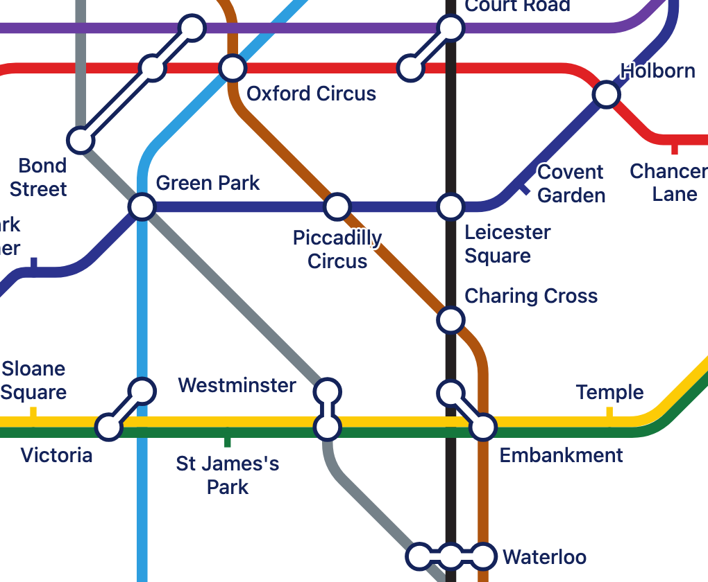

# tubeline

[Website and live demo](https://nikhil-verma.com/tubeline/) · [npm](https://www.npmjs.com/package/@nikhilverma/tubeline) · [Agent skill](./skills/)

**Draw any graph as an interactive tube map.**

tubeline is a graph renderer. You give it nodes and the paths between them as
JSON, and it draws them the way a city draws its underground: coloured lines,
named stations, and interchanges where lines meet.

People already know how to read a tube map. They can follow a line with a
finger, see where to change, and plan a route without being taught. tubeline
borrows that for any graph: a workflow, a state machine, a build pipeline, a
service map, or a real transit network.

- **Interactive.** Pan, zoom, hover for metadata, pick a line out from the key.
- **Plans journeys.** Select two stations and it finds the cheapest route with A*.
- **Works with the keyboard** and announces changes to screen readers.
- **Small.** TypeScript, no dependencies, one ES module.

## Install

```sh
npm install @nikhilverma/tubeline
```

## Quick start

```ts
import { createTubeMap } from '@nikhilverma/tubeline'

const map = createTubeMap(document.querySelector('#map')!, {
  name: 'Order workflow',
  stations: [
    { id: 'cart', name: 'Cart' },
    { id: 'checkout', name: 'Checkout' },
    { id: 'paid', name: 'Paid', metadata: { owner: 'billing' } },
    { id: 'cancelled', name: 'Cancelled' },
  ],
  lines: [
    { id: 'happy', name: 'Happy path', stations: ['cart', 'checkout', 'paid'] },
    { id: 'cancel', name: 'Cancellation', stations: ['checkout', 'cancelled'] },
  ],
})

const journey = map.showJourney('cart', 'cancelled')
```

The map fills its container, so give the container a height.

## How a graph becomes a tube map

| In your graph | On the map |
| --- | --- |
| A node | A station |
| A named path through nodes | A line, in its own colour |
| A node on several paths | An interchange |
| A directed edge | Track with an arrow |
| An edge's weight | The cost of that step in a journey |
| Data on a node or edge | A tooltip |

## First principles

These are the rules the library is built on.

1. **It is a graph first.** The tube map is the interface, and the data underneath is nodes, paths and weighted, directed edges. Nothing in the library knows about trains.
2. **Track runs in eight directions only.** Every stretch is horizontal, vertical or at 45°. This one rule is most of what makes a tube map look like a tube map.
3. **A line runs straight through a station.** Each stretch between two stations gets at most one bend, and the bend sits away from the stations where it can.
4. **Lines that share track run side by side.** They touch, keep their order, and share one station mark.
5. **A station is a tick, and an interchange is a ring.** Lines that stop a short way apart get a ring each, joined by a walkway.
6. **Your positions are kept.** Give positions and the map draws your design. Leave them out and it places the stations itself, which suits small graphs.
7. **The layout is plain geometry.** Positions, track and names are worked out before anything is drawn, without a browser. That is why the layout can be unit tested.
8. **Routing is separate from drawing.** `findJourney` and `parseTubeMap` never touch the page, so they also run in Node.
9. **Bad data fails loudly, once.** `parseTubeMap` checks the whole JSON and reports every problem together.
10. **The map keeps to itself.** It is drawn in a shadow root, so your page's styles and the map's styles can't affect each other.

## The JSON

| Field | What it is |
| --- | --- |
| `stations[].id` | Required. Lines and connections refer to it. |
| `stations[].name` | Shown on the map. Falls back to the id. |
| `stations[].x`, `y` | The station's place on a grid. `y` grows downwards. Give every station a position, or none. |
| `stations[].platforms` | Where single lines stop, for a station whose lines stop a short way apart: `{ "lineId": { "x": 4, "y": 1 } }`. The stops are drawn as discs joined by a walkway. |
| `stations[].labelSide` | Pins the name to a side: `n`, `ne`, `e`, `se`, `s`, `sw`, `w` or `nw`. |
| `name` | The map's name, read out to screen readers. |
| `lines[].id` | Required. Connections refer to it. |
| `lines[].name` | Shown in the key. Falls back to the id. |
| `lines[].stations` | Station ids in order. End on the first station to make a loop. |
| `lines[].branches` | Extra stretches of the same line, for a line that forks. |
| `lines[].color` | Any CSS colour. Falls back to a built-in palette. |
| `lines[].oneWay` | Travel only in the listed order. Use it for directed graphs. |
| `connections[]` | Changes travel in one direction between two neighbouring stations, `from` and `to`. |
| `connections[].line` | The line the change applies to. Left out, it applies to every line that joins the two. |
| `connections[].cost` | What the step costs a journey. 1 by default. |
| `connections[].closed` | Set to `true` to stop travel in this direction. |
| `metadata` | Free-form data on a station, line or connection. |

**Positions.** With positions, the map draws exactly the layout you designed.
Track between two stations always runs horizontally, vertically or at 45°.
Without positions, the map places the stations itself. That is a quick
heuristic, good for small graphs, and lines may cross.

**Connections.** A line joins its stations both ways at a cost of 1. A
connection changes one direction of one step:

```json
[
  { "from": "exchange", "to": "riverside", "line": "harbour", "cost": 3, "metadata": { "note": "Slow tunnel" } },
  { "from": "ashdown", "to": "easterly", "closed": true }
]
```

Track that can only be travelled one way is drawn with an arrow.

## Journeys

`findJourney(network, from, to, options)` returns the cheapest journey, or
`null` when no route joins the stations. A journey's cost is the cost of every
step plus `interchangeCost` (2 by default) for each change of line.

The search is A*. When stations have positions, the straight-line distance to
the destination steers it. Without positions it behaves as Dijkstra's
algorithm. Both return a cheapest journey.

```ts
import { findJourney, parseTubeMap } from '@nikhilverma/tubeline'

const network = parseTubeMap(json) // throws TubeMapDataError listing every problem
const journey = findJourney(network, 'cart', 'paid', { interchangeCost: 0 })
// { from, to, cost, legs: [{ line, hops: [{ from, to, line, cost, metadata }] }] }
```

`parseTubeMap` and `findJourney` don't touch the DOM, so they also run in Node.

## The map

`createTubeMap(container, data, options)` returns:

| Member | What it does |
| --- | --- |
| `showJourney(from, to)` | Plans a journey, shows it on the map and returns it. Throws on an unknown station id. |
| `clearJourney()` | Removes the journey. |
| `focusLine(lineId \| null)` | Picks one line out, or shows them all again. |
| `resetView()` | Fits the whole map in view. |
| `on(type, listener)` | Listens for `station:select`, `journey:change` or `line:focus`. Returns a function that stops listening. |
| `destroy()` | Removes the map and its listeners. |
| `network` | The checked form of the JSON. |

Options: `interchangeCost`, and `legend` and `journeyPanel`, which hide the
key and the journey panel when set to `false`.

People can also plan a journey on the map itself: select a start, then a
destination. Selecting the start again takes it back. Stations work with the
keyboard: Tab to reach one, Enter or Space to select it, Escape to clear.

## Theming

The map is drawn in a shadow root, so page styles don't affect it. Set these
custom properties on the container to theme it:

| Property | Default |
| --- | --- |
| `--tubeline-background` | `#ffffff` |
| `--tubeline-ink` | `#14235a` |
| `--tubeline-accent` | `#0b6bcb` |
| `--tubeline-panel-background` | `rgb(255 255 255 / 0.94)` |
| `--tubeline-font` | the system font |

## How close is it to a real tube map?

We measured it. We took a 136 × 112 pt area of central London from the
official map, gave tubeline the same stations at the same positions, rendered
both at the same size, and compared them pixel by pixel.

The first comparison found the biggest gaps. We fixed those, then measured again.

| Measure | Before | After |
| --- | --- | --- |
| Pixels that differ | 22.8% | 14.2% |
| Central line overlap | 0.07 | 0.86 |
| Victoria line overlap | 0.22 | 0.92 |
| Bakerloo line overlap | 0.33 | 0.84 |
| Jubilee line overlap | 0.01 | 0.43 |

Overlap is the share of pixels the two drawings of a line have in common. It
is 1 when they cover exactly the same pixels.

What closed the gap:

- Lines can stop at their own platforms inside one station.
- Bends move away from stations, so lines run straight through.
- Lines on shared track touch each other.
- Interchanges are rings joined by walkways.
- Names avoid each other before they avoid track.

What is still different:

- The official map uses its own typeface. tubeline uses yours.
- tubeline has no step-free, rail or river symbols, and draws no river.
- tubeline allows one bend between two stations. The official map sometimes uses two.
- tubeline draws every line solid. The official map also has hollow and dashed lines.

This is tubeline's own drawing of that area:



The official map is not included here. It belongs to Transport for London.

## Compared with other libraries

We checked these on npm in November 2026.

| Library | What it is for | How it differs |
| --- | --- | --- |
| [d3-tube-map](https://www.npmjs.com/package/d3-tube-map) | Drawing tube maps with d3. | The closest in looks. It needs d3, and its last release was in 2020. Its README warns that it "can be difficult to work with". |
| [transit-map](https://www.npmjs.com/package/transit-map) | Working out a metro-map layout with an optimiser. | It produces a layout, not an interactive map. Its README says it needs a commercial solver and is not for production. Its last release was in 2018. |
| [Cytoscape.js](https://www.npmjs.com/package/cytoscape), [vis-network](https://www.npmjs.com/package/vis-network) | General graph drawing and analysis. | Use them for large or arbitrary graphs. They draw nodes and edges, not lines and stations. |
| [React Flow](https://www.npmjs.com/package/@xyflow/react) | Node-based editors and flow charts in React. | Use it when people edit the graph. tubeline only shows it. |
| [Mermaid](https://www.npmjs.com/package/mermaid) | Diagrams written as text. | Use it for diagrams that live in documents. |
| [ELK](https://www.npmjs.com/package/elkjs), [dagre](https://www.npmjs.com/package/@dagrejs/dagre) | Graph layout only. | They place nodes and leave the drawing to you. |

tubeline fits when the graph has a few named paths that people follow from end
to end, and when a reader should be able to plan a route across it. It is the
wrong tool for a graph with thousands of nodes, or one with no paths in it.

## For agents

An AI coding agent can add tubeline to a project from the skill in
[`skills/tubeline`](./skills/tubeline/SKILL.md). It covers the JSON, the API
and the common mistakes in one short file.

```sh
npx skills add NikhilVerma/tubeline
```

The same file ships inside the npm package, at
`node_modules/@nikhilverma/tubeline/skills/tubeline/SKILL.md`, and is served at
<https://nikhil-verma.com/tubeline/llms.txt>.

## Development

```sh
pnpm install
pnpm dev            # the demo page
pnpm test           # unit tests
pnpm test:e2e       # builds, then runs the browser tests headless
pnpm release:check  # everything a release has to pass
```

Releases are published from GitHub Actions with npm trusted publishing. To
release, raise `version` in `package.json`, add the changes to `CHANGELOG.md`,
and merge to `main`.

## Limits

- The text in the journey panel and controls is English only.
- A map can't be updated in place. Destroy it and create a new one.
- Placing stations automatically is a heuristic. Give positions for a map that has to look exactly right.
- Every station and piece of track is an SVG element, so very large maps are slow to move round. See the next section.

## How big a map can it draw?

We tried it on a made-up city: stations on a grid, joined by lines of about 25 stops. The times are from one laptop, with Chromium for the drawing.

| Stations | Work out the layout | Draw it | Show a journey | Panning |
| --- | --- | --- | --- | --- |
| 100 | 12 ms | 15 ms | 32 ms | 60 frames a second |
| 1,000 | 55 ms | 90 ms | 113 ms | about 50 |
| 10,000 | 430 ms | 800 ms | 153 ms | about 10 |

"Draw it" includes working out the layout. Placing stations automatically adds to it: about 2 seconds at 10,000 stations.

Up to a few thousand stations the map feels quick. At 10,000 it appears in under a second, but dragging it is slow, because the browser redraws about 100,000 SVG elements on every move.

Finding a journey takes about 10 ms at 10,000 stations, and it runs without a browser.

## License

MIT
